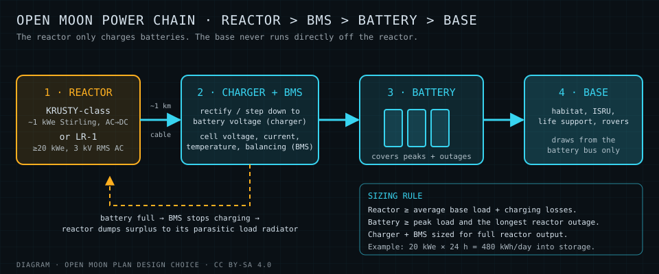

## How much power does a base need?

NASA studies give concrete numbers:

| Load | Power | Source |
|---|---|---|
| Oxygen plant making 1.63 kg/h of O₂ | 25.83 kW | Colozza (NASA)[10](#s10) |
| Six-person base camp | 28.05 kW | Colozza[10](#s10) |
| Habitat, 4 crew, 30+ days | 20–50 kW | Csank & Scott (NASA)[1](#s1) |
| ISRU at scale | 60+ kW | Csank & Scott[1](#s1) |
| Growth path | 1–5 → 10–20 → 80–100 kW | Csank & Scott[1](#s1) |

This milestone targets about 120 kW of total capacity: 100 kW of solar peak plus 20 kWe of fission from one LR-1-class reactor (design change DD-002). That's enough for the oxygen pilot plant (M06) and the first habitat (M08), with room to grow.

## Why not just solar, or just batteries?

- **Sunlight.** The best points on the ridge connecting Shackleton and de Gerlache craters are sunlit **92.27%** of the time at 2 m height and **95.65%** at 10 m[11](#s11). Shadow periods still happen, and NASA cites intermittent darkness of up to about 100 hours at the pole[1](#s1).
- **Storage maths** (this plan's arithmetic):
  - Keeping 30 kW of essential load alive for 100 hours takes 3 MWh.
  - Li-ion stores about 160 Wh/kg, so that's about **19 t** of batteries[1](#s1).
  - Regenerative fuel cells store 320–650 Wh/kg[1](#s1), which cuts it to about **5–9 t**.
  - Either way, that much storage is heavy to land.
- **Fission.** NASA's 2022 reference design was a 40 kWe reactor of about 10 t[1](#s1). The reactor NASA is now buying, Lunar Reactor-1, gives at least 20 kWe for at least 5 years[25](#s25). That is 480 kWh a day into the base battery, through any darkness (this plan's arithmetic). For long darkness it's the lightest answer, and it lets solar handle peaks.

## The reactor: what's real today

- **KRUSTY (2018).** For under $20 million, NASA and DOE designed, built and ran a real fission reactor with Stirling converters for 28 hours straight, at various power levels[5](#s5).
- **NASA reference design.** 40 kWe, about 10 t, four pairs of Stirling engines, sodium heat pipes, 10-year life[1](#s1).
- **Moving target.** The US programme has changed requirements several times: 40 kWe in 2022[1](#s1), then at least 100 kWe with closed Brayton conversion in 2025[12](#s12). In 2026 it settled on "Lunar Reactor-1": at least 20 kWe, at least 5 years, HALEU fuel, under 15 t[6](#s6)[14](#s14). No contract has been awarded yet. Open Moon now plans on that 20 kWe minimum (see design change DD-002 below).



## Reactor > BMS > Battery > Base

- **The reactor only charges batteries.** The 3 kV AC line from the reactor ends at a charger at the base. The charger converts it to the battery's charging voltage, and a battery management system (BMS) watches every cell and controls charging. The base's loads draw fission power only from the battery bus.
- **Why it fits.** LR-1 must accept any load from 0 to 100% of its output and starts up into a parasitic load radiator[25](#s25). So when the battery is full and the BMS stops charging, the reactor dumps the surplus as heat. Stirling reactors already work this way: NASA's 40 kWe Stirling concept dumped unused power into a resistor bank or radiator[15](#s15).
- **Battery size (plan design).** 160 kWh per 20 kWe reactor, in two strings: 8 hours at full output, about the time NASA's reference reactor takes to start up[26](#s26). At 160 Wh/kg[1](#s1) that is about 1 t.
- **KRUSTY-class units.** A 1 kWe Kilopower-type unit puts 24 kWh a day into storage. That suits a remote comms or science node, not the habitat. No flight unit is being built.

## Solar towers

- **VSAT.** NASA funded three prototypes in 2022 for $19.4M in total; they deploy to about 10 m[4](#s4). Each is a 10 kW-class array[20](#s20).
- **VSAT-XL.** Astrobotic's design is 50 kW and 34 m tall, using Redwire roll-out arrays[7](#s7). NASA then gave it an SBIR Phase II contract running from June 2025 to June 2027[17](#s17)[18](#s18).
- **Why height matters.** Taller masts see over the horizon and catch more hours of sun[11](#s11).

## Cables



- **Voltage and frequency.** In its 2022 grid trade study NASA compared 1.2–6 kV DC and 3-phase AC at 60 Hz to 1 kHz. It found **1 kHz the lightest AC option** and chose **3 kV AC as the mass-optimal feasible design**[23](#s23).
- **Why not DC?** NASA says DC would be lighter above 3–4 kV, but a DC grid is "practically limited to 1.2–1.5 kV, due to lack of high voltage rad-hard switches". AC voltage can be changed with transformers, and "these facts drove team to select AC"[23](#s23).
- **NASA's reactor uses it.** NASA's 2025 fission reference design sends power 1 km over a **3 kVac, 1 kHz** link, "selected to leverage the Universal Modular Interface Converter (UMIC)". It found no mass benefit above 3 kVac at 1 km, and dropping to 1 kVac added 570 kg[21](#s21).
- **Connecting equipment.** The UMIC links 120 V DC space equipment to the 3 kV AC grid. It is built from standard 1 kW modules, with targets of over 85% efficiency and under 0.55 kg/m[22](#s22).
- **Tested with lunar dirt.** NASA tested AC cables in vacuum with regolith simulant, coiled, buried and apart, and found no major losses. The frequency did not change the results[24](#s24).
- **Why not beam power wirelessly?** Power beaming was 13–27% efficient and would need 30–60 t of extra generating capacity to make up the losses[2](#s2).
- **Cable mass.** NASA's 2025 reactor reference lists **325 kg for a 1 km main cable and spool** on the 3 kVac link[21](#s21), heavier than the ~240 kg per 3 km NASA once estimated for a 2,800 V DC cable[15](#s15). Because the reactor is heavy (about 0.25 kg per watt), the line must still be efficient: any power lost in the cable has to be made up with extra generating capacity[2](#s2).
- **Laying the cable.** Astrobotic's LunaGrid-Lite is designed to transmit 1 kW; its 2025 design lays about 500 m of cable[8](#s8). NASA's 2023 award described 1 km[19](#s19).

## Where the money goes

About **85%** of this milestone's cost is **delivery**, not hardware. Two things change that:

1. **Cheaper heavy cargo landers (M02).**
2. **Making power hardware on the Moon.** Blue Origin's Blue Alchemist has made solar cells and wire from regolith simulant[13](#s13). Scaling that up is part of M12.

## Step-by-step

1. **First landing (small lander):** a 10 kW VSAT, a LunaGrid-Lite-class cable rover, and the LTE kit from M03.
2. **Second 10 kW VSAT** on a second ridge point, with a cable link between the two.
3. **Two 50 kW VSAT-XL towers** on medium landers.
4. **Regenerative fuel cell storage**, sharing tanks with the M06 water plant.
5. **Fission battery, charger and BMS** installed at the base end of the reactor cable, in two strings.
6. **Fission unit on a heavy lander.** Rovers set it 1–3 km from the habitat zone behind terrain, then it starts remotely into its parasitic load radiator and begins charging the battery.
7. **Close the grid** so it survives losing any single source.
