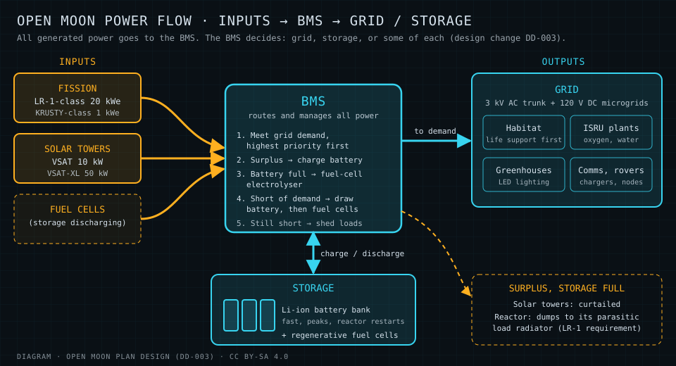

## How much power does a base need?

NASA studies give concrete numbers:

| Load | Power | Source |
|---|---|---|
| Oxygen plant making 1.63 kg/h of O₂ | 25.83 kW | Colozza (NASA)[10](#s10) |
| Six-person base camp | 28.05 kW | Colozza[10](#s10) |
| Habitat, 4 crew, 30+ days | 20–50 kW | Csank & Scott (NASA)[1](#s1) |
| ISRU at scale | 60+ kW | Csank & Scott[1](#s1) |
| Growth path | 1–5 → 10–20 → 80–100 kW | Csank & Scott[1](#s1) |

This milestone targets about 120 kW of total capacity (provisional until the Phase 1 load budget): 100 kW of solar peak from 10 kW VSATs plus 20 kWe of fission from one LR-1-class reactor (design change DD-002). That's enough for the oxygen pilot plant (M06) and the first habitat (M08), with room to grow.

## Why not just solar, or just batteries?

- **Sunlight.** The best points on the ridge connecting Shackleton and de Gerlache craters are sunlit **92.27%** of the time at 2 m height and **95.65%** at 10 m[11](#s11). Shadow periods still happen, and NASA cites intermittent darkness of up to about 100 hours at the pole[1](#s1).
- **Storage maths** (this plan's arithmetic):
  - Keeping 30 kW of essential load alive for 100 hours takes 3 MWh.
  - Li-ion stores about 160 Wh/kg, so that's about **19 t** of batteries[1](#s1).
  - Regenerative fuel cells store 320–650 Wh/kg[1](#s1), which cuts it to about **5–9 t**.
  - Either way, that much storage is heavy to land.
- **Fission.** NASA's 2022 reference design was a 40 kWe reactor of about 10 t[1](#s1). The reactor NASA is now buying, Lunar Reactor-1, gives at least 20 kWe for at least 5 years[25](#s25). That is 480 kWh a day into the base battery, through any darkness (this plan's arithmetic). For long darkness it's the lightest answer, and it lets solar handle peaks.

## The reactor: what's real today

- **KRUSTY (2018).** For under $20 million, NASA and DOE designed, built and ran a real fission reactor with Stirling converters for 28 hours straight, at various power levels[5](#s5).
- **NASA reference design.** 40 kWe, about 10 t, four pairs of Stirling engines, sodium heat pipes, 10-year life[1](#s1).
- **Moving target.** The US programme has changed requirements several times: 40 kWe in 2022[1](#s1), then at least 100 kWe with closed Brayton conversion in 2025[12](#s12). In 2026 it settled on "Lunar Reactor-1": at least 20 kWe, at least 5 years, HALEU fuel, under 15 t[6](#s6)[14](#s14). No contract has been awarded yet. Open Moon now plans on that 20 kWe minimum (see design changes DD-002 and DD-003 below).





## How power flows: inputs, BMS, storage, outputs

- **Inputs.** The reactor and the solar towers always send their power to the BMS. Nothing feeds a load directly.
- **The BMS decides.** In this plan BMS means the base's central power management and routing system, including battery cell management. Moment to moment it sends power to the grid to meet demand, into storage, or some of each.
- **The grid has only two feeds:** generation passing through the BMS, or the battery. The regenerative fuel cells never feed the grid directly; when they discharge, they recharge the battery.
- **Default routing (plan design).**
  1. Meet grid demand, highest priority first (life support before everything else). NASA's lunar microgrid concept also has a controller that serves the highest-priority loads first[1](#s1).
  2. Charge the Li-ion battery with any surplus.
  3. With the battery full, run the fuel-cell electrolyser to fill long-term storage.
  4. With all storage full, curtail the solar towers and let the reactor dump its surplus to its parasitic load radiator. LR-1 must accept any load from 0 to 100% of its output and starts up into that radiator[25](#s25). NASA's 40 kWe Stirling concept also dumped unused power into a resistor bank or radiator[15](#s15).
  5. When short: the battery feeds the grid; the fuel cells recharge the battery; as a last resort, shed loads by priority.
- **Outputs.** The grid: the 3 kV AC trunk and the 120 V DC habitat and ISRU microgrids (C04.4).
- **Battery size (plan design).** About 260 kWh of Li-ion: 160 kWh per 20 kWe reactor, which is 8 hours at full output, about the time NASA's reference reactor takes to start up[26](#s26), plus about 100 kWh for fast peaks. At 160 Wh/kg[1](#s1) that is about 1.6 t.
- **No single point of failure.** The BMS is split into two independent halves (A and B) with a cross-tie. Each can carry the essential loads, and every source and feeder can be switched to either half.
- **KRUSTY-class units.** A 1 kWe Kilopower-type unit gives 24 kWh a day. That suits a remote comms or science node, not the habitat. No flight unit is being built.

## Site layout

- **Solar towers** stand on two or three ridge points, so that when one is in shadow another is usually lit (plan design; see M00). Each tower has its own source line to the BMS hub.
- **The reactor** sits 1–3 km from the habitat zone, behind terrain (plan design, DD-002). NASA's reference shield has a 36° included angle and keeps the dose below 5 rem/yr at 1 km[26](#s26), so the shield's shadow is pointed at the crew zone.
- **The BMS hub** sits near the habitat zone (plan design). Every source line ends there. Feeders go out from it to the habitat and ISRU microgrids.
- **Landing pads** stay at least 1 km from the towers and radiators, to limit dust (plan design).
- **Cables** lie on the surface. NASA advises against burying them, because regolith traps heat[21](#s21).

## One-line diagram

![One-line diagram: each solar tower and the reactor send 3 kV AC over a source line to an input converter on BMS half A or half B, joined by a cross-tie; Li-ion battery strings hang off each half; the fuel cells are charged from BMS surplus and discharge only into the battery, with no direct path to the grid; output converters send 3 kV AC feeders to transformers and UMICs at the 120 V DC habitat and ISRU microgrids; the reactor's parasitic load radiator takes surplus and solar towers curtail on BMS command](/assets/tech/base-power-one-line.svg)

This is the plan's design, simplified to one line per 3-phase circuit. The source lines and feeders run at 3 kV AC, NASA's lunar grid baseline[23](#s23). UMIC converters link the 120 V DC microgrids to the 3 kV AC feeders[22](#s22). The BMS buses, the converters inside the hub and the battery and fuel-cell connections are plan design (DD-003).

## Solar towers

- **VSAT.** NASA funded three prototypes in 2022 for $19.4M in total; they deploy to about 10 m[4](#s4). Each is a 10 kW-class array[20](#s20).
- **Only 10 kW VSATs (DD-004).** The number of towers will come from the Phase 1 load budget. Until then the plan costs 10 towers (100 kW) as a provisional figure.
- **Not used: VSAT-XL.** Astrobotic's 50 kW, 34 m design[7](#s7) is still a ground deployment prototype, under an SBIR Phase II contract to June 2027[17](#s17)[18](#s18). It is kept as an alternative only.


- **Why height matters.** Taller masts see over the horizon and catch more hours of sun[11](#s11).

## Cables



- **Voltage and frequency.** In its 2022 grid trade study NASA compared 1.2–6 kV DC and 3-phase AC at 60 Hz to 1 kHz. It found **1 kHz the lightest AC option** and chose **3 kV AC as the mass-optimal feasible design**[23](#s23).
- **Why not DC?** NASA says DC would be lighter above 3–4 kV, but a DC grid is "practically limited to 1.2–1.5 kV, due to lack of high voltage rad-hard switches". AC voltage can be changed with transformers, and "these facts drove team to select AC"[23](#s23).
- **NASA's reactor uses it.** NASA's 2025 fission reference design sends power 1 km over a **3 kVac, 1 kHz** link, "selected to leverage the Universal Modular Interface Converter (UMIC)". It found no mass benefit above 3 kVac at 1 km, and dropping to 1 kVac added 570 kg[21](#s21).
- **Connecting equipment.** The UMIC links 120 V DC space equipment to the 3 kV AC grid. It is built from standard 1 kW modules, with targets of over 85% efficiency and under 0.55 kg/m[22](#s22).
- **Tested with lunar dirt.** NASA tested AC cables in vacuum with regolith simulant, coiled, buried and apart, and found no major losses. The frequency did not change the results[24](#s24).
- **Why not beam power wirelessly?** Power beaming was 13–27% efficient and would need 30–60 t of extra generating capacity to make up the losses[2](#s2).
- **Cable mass.** NASA's 2025 reactor reference lists **325 kg for a 1 km main cable and spool** on the 3 kVac link[21](#s21), heavier than the ~240 kg per 3 km NASA once estimated for a 2,800 V DC cable[15](#s15). Because the reactor is heavy (about 0.25 kg per watt), the line must still be efficient: any power lost in the cable has to be made up with extra generating capacity[2](#s2).
- **Laying the cable.** Astrobotic's LunaGrid-Lite is designed to transmit 1 kW; its 2025 design lays about 500 m of cable[8](#s8). NASA's 2023 award described 1 km[19](#s19).

## Where the money goes

About **85%** of this milestone's cost is **delivery**, not hardware. Two things change that:

1. **Cheaper heavy cargo landers (M02).**
2. **Making power hardware on the Moon.** Blue Origin's Blue Alchemist has made solar cells and wire from regolith simulant[13](#s13). Scaling that up is part of M12.

## Step-by-step

1. **First landing (small lander):** a 10 kW VSAT, BMS half A with a starter battery string, a LunaGrid-Lite-class cable rover, and the LTE kit from M03. From the first watt, power flows through the BMS.
2. **Second 10 kW VSAT** on a second ridge point, with a cable link between the two.
3. **More 10 kW VSATs** on medium landers, up to the number the Phase 1 load budget sets (provisionally 8 more, for 10 in total).
4. **Regenerative fuel cell storage**, sharing tanks with the M06 water plant, connected to the BMS.
5. **BMS half B and the reactor ride-through battery strings**, with the cross-tie to half A.
6. **Fission unit on a heavy lander.** Rovers set it 1–3 km from the habitat zone behind terrain, then it starts remotely into its parasitic load radiator and is switched over to feed the BMS.
7. **Close the grid** so it survives losing any single source.
