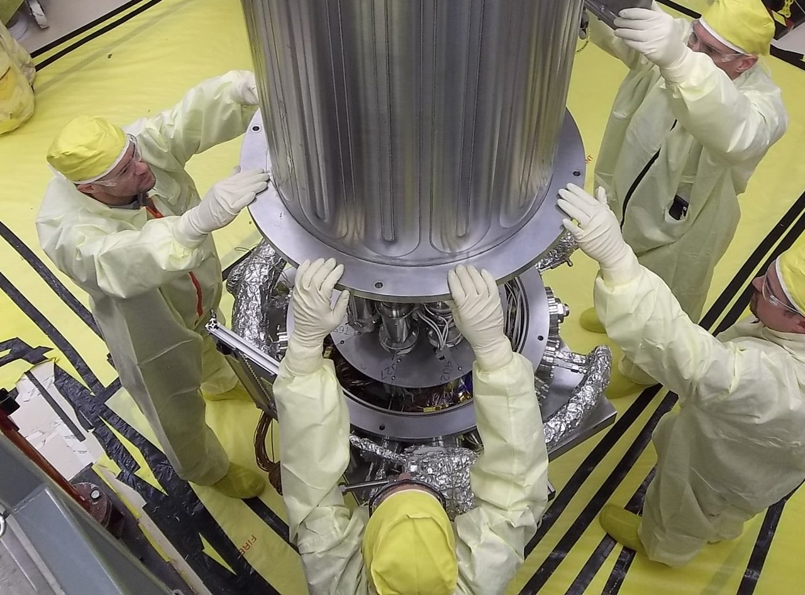
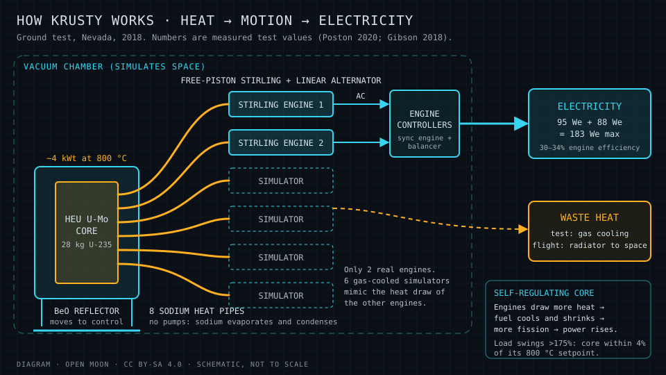
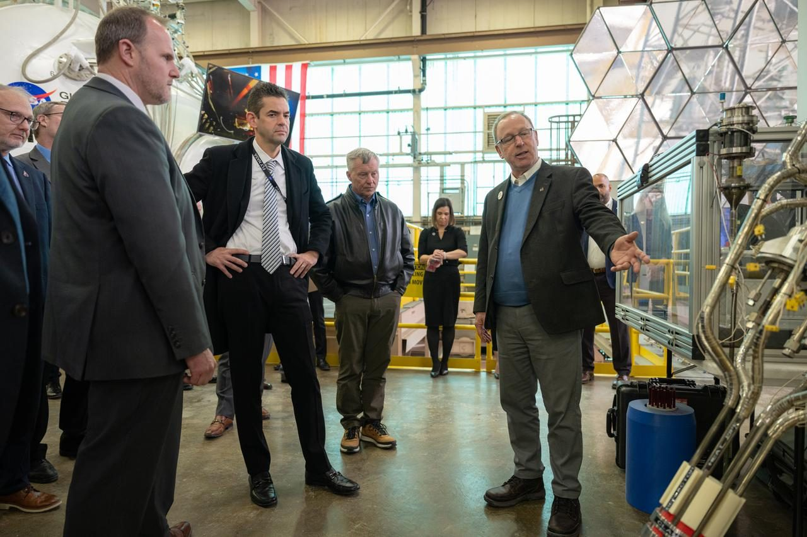
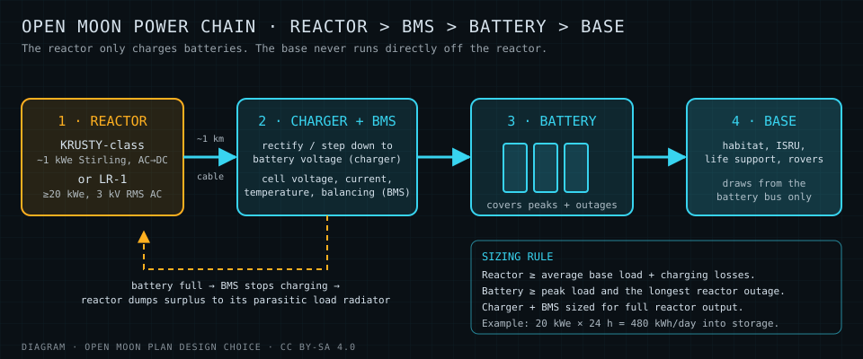

## What it is

**Kilopower** was NASA's project, run from 2015 to 2018, to build a small, simple fission reactor that could scale from **1 to 10 kWe** ([Gibson et al. 2018](https://ntrs.nasa.gov/citations/20180005435)). NASA's Glenn Research Center led it with Marshall, the Department of Energy's NNSA, Los Alamos National Laboratory, the Y-12 National Security Complex and the Nevada National Security Site ([NASA](https://www.nasa.gov/directorates/spacetech/kilopower)).

**KRUSTY** (Kilopower Reactor Using Stirling TechnologY) was the project's one real reactor. It was a ground-test prototype of the **1 kWe** Kilopower flight design. Its core, reflectors, heat pipes, Stirling simulators and shield structure were all full scale ([Gibson et al. 2018](https://ntrs.nasa.gov/citations/20180005435)). It ran at full power for 28 hours in Nevada on 20–21 March 2018 ([Poston et al. 2020](https://ntrs.nasa.gov/citations/20205009351)). It was the first space fission reactor test in over 50 years ([Gibson et al. 2018](https://ntrs.nasa.gov/citations/20180005435)).

| | Kilopower | KRUSTY |
|---|---|---|
| What | Project and flight design family | One ground-test reactor |
| Power | 1 kWe and 10 kWe flight concepts | 4–5 kWt heat; 183 We from 2 engines |
| Hardware | No flight unit was ever built | Built, nuclear tested, now on show at NASA Glenn |
| Status | Project ended; fed into Fission Surface Power | Test complete 2018 |

<figure class="tfig"></figure>

Photo NASA and NNSA engineers lower the wall of the vacuum chamber around KRUSTY before the nuclear test, Nevada, 2018. Credit: Los Alamos National Laboratory. <a href="https://www.nasa.gov/news-release/demonstration-proves-nuclear-fission-system-can-provide-space-exploration-power/">Image source: NASA release 18-031 ↗</a>

## How it works

1. **Core.** A solid cast cylinder of highly enriched uranium alloyed with molybdenum, in three sections ([Gibson et al. 2018](https://ntrs.nasa.gov/citations/20180005435)). It is 93% uranium-235 and 7% molybdenum ([Wikipedia](https://en.wikipedia.org/wiki/Kilopower)), and about the size of a paper towel roll ([NASA](https://www.nasa.gov/news-release/demonstration-proves-nuclear-fission-system-can-provide-space-exploration-power/)).
2. **Control.** Beryllium oxide reflectors around the core bounce neutrons back. In the test the team raised and lowered the reflectors. A flight unit would use one boron carbide rod in the centre ([Gibson et al. 2018](https://ntrs.nasa.gov/citations/20180005435)).
3. **Heat pipes.** Eight sodium heat pipes clamp into slots in the fuel and carry heat to the engines with no pumps ([Poston et al. 2020](https://ntrs.nasa.gov/citations/20205009351)).
4. **Stirling engines.** Each free-piston Stirling engine drives a linear alternator, a magnet moving back and forth in a coil ([Wikipedia](https://en.wikipedia.org/wiki/Kilopower)). KRUSTY had two real 80 W Sunpower engines and six gas-cooled simulators that drew the same heat as engines would. A dedicated controller ran each engine and its vibration balancer ([Gibson et al. 2018](https://ntrs.nasa.gov/citations/20180005435)).
5. **Self-regulation.** If the engines draw more heat, the fuel cools and shrinks, and fission power rises. During load swings of over 175%, the core stayed within 4% of its 800 °C setpoint ([Gibson et al. 2018](https://ntrs.nasa.gov/citations/20180005435)).

<figure class="tfig"></figure>

Photo Lee Mason, NASA's fission surface power chief technologist (right), shows KRUSTY to NASA Administrator Jared Isaacman at Glenn's Electric Propulsion and Power Laboratory, 27 January 2026. Credit: NASA/John Kraus. Licence: NASA media (public domain in the US). <a href="https://images.nasa.gov/details/NHQ20260127_admin_0004">Image source ↗</a>

## Testing

KRUSTY was tested step by step, with electric heat first and nuclear heat last.

| Year | Test | What it showed |
|---|---|---|
| 2012 | DUFF proof-of-concept nuclear test | That NASA and NNSA could nuclear-test affordably in existing DOE facilities ([Gibson 2018](https://ntrs.nasa.gov/citations/20180005435)) |
| 2015 | Material and subcomponent tests; full-scale thermal prototype | Creep and fuel–heat-pipe diffusion data. Sodium heat pipes moved about 4 kW of heat over 1 m from an electrically heated stainless steel core ([Gibson 2017](https://ntrs.nasa.gov/citations/20170002010)) |
| 2016 | Non-nuclear system tests at NASA Glenn | Surrogate stainless steel core, Haynes 230 sodium heat pipes and Stirling conversion working together ([Gibson 2017](https://ntrs.nasa.gov/citations/20170002010)) |
| 2017 | Electrically heated system test with a depleted-uranium core | Same dimensions as the real core; also trained the team to fuel the reactor ([Gibson 2017](https://ntrs.nasa.gov/citations/20170002010)) |
| Nov 2017–Mar 2018 | Full electrical test, then zero-power ("cold") criticals, then nuclear-heated ("warm") criticals | Nuclear behaviour at low power; models benchmarked before the final run ([Poston 2020](https://ntrs.nasa.gov/citations/20205009351)) |
| 20–21 Mar 2018 | 28-hour nuclear system test | Startup, full power, load changes, loss of an engine and loss of all cooling. Safety limit was fuel below 900 °C ([Poston 2020](https://ntrs.nasa.gov/citations/20205009351)) |

**Results.** All three test objectives were met. The reactor reached 4 kWt or more at 800 °C, followed every load change, and produced code-benchmark data. NASA rated the reactor's nuclear and mechanical systems at **TRL 5** ([Gibson et al. 2018](https://ntrs.nasa.gov/citations/20180005435)). Fuel peaked at about 880 °C ([Poston et al. 2020](https://ntrs.nasa.gov/citations/20205009351)). The whole test cost less than $20 million ([Poston et al. 2020](https://ntrs.nasa.gov/citations/20205009351)).

## Why it is rated TRL 5, and what TRL 6–9 would need

KRUSTY worked very well as a reactor, yet NASA rated its nuclear and mechanical systems at **TRL 5** ([Gibson 2018](https://ntrs.nasa.gov/citations/20180005435)). The reason is that the Technology Readiness Level (TRL) scale measures how close the *whole system* is to flying, not how well one test went. KRUSTY proved the reactor, but it was never a complete, flight-like power system.

| TRL | NASA hardware definition (simplified) | KRUSTY |
|---|---|---|
| **5** | A "medium fidelity" breadboard run in a simulated operational environment "with realistic support elements" | **Met.** Real nuclear heat, in a vacuum chamber |
| **6** | A "high fidelity" prototype that "adequately addresses all critical scaling issues", run in a relevant environment "under critical environmental conditions" | **Not met.** Key flight parts were missing or replaced by test stand-ins |
| **7** | A high-fidelity engineering unit run in "the actual operational environment and platform" (in space or on the Moon) | **Not met.** Never left the ground |
| **8** | "The final product in its final configuration", qualified by test for its environment | **Not met** |
| **9** | The final product "successfully operated in an actual mission" | **Not met** |

Definitions: [NASA TRL definitions](https://www.nasa.gov/wp-content/uploads/2017/12/458490main_trl_definitions.pdf).

### What it is missing for TRL 6

- **Real engines.** Two undersized 80 W engines and six heat-only simulators stood in for eight flight-design 125 W engines ([Gibson 2018](https://ntrs.nasa.gov/citations/20180005435)). This is the biggest gap: the full 1 kWe system never ran on nuclear heat.
- **Real control rod.** The flight boron carbide rod was never tested; the test moved the reflectors on a lab machine instead ([Poston 2020](https://ntrs.nasa.gov/citations/20205009351)).
- **Real heat rejection.** Gas cooling in the chamber stood in for the flight radiator.
- **Flight controllers and power electronics.** Lab units were used, not flight designs.
- **Launch and landing loads.** No vibration or shock testing was done; the reports say launch and landing loads were only roughly considered ([Poston 2020](https://ntrs.nasa.gov/citations/20205009351)).
- **Low-gravity heat pipes.** In Earth gravity the heat pipes partly worked as thermosiphons. They still need qualifying for low gravity ([Poston 2020](https://ntrs.nasa.gov/citations/20205009351)).
- **Duration.** 28 hours against a 10-year design life. Long-term creep and diffusion between metals are untested ([Poston 2020](https://ntrs.nasa.gov/citations/20205009351)).

**Path to TRL 6:** build a flight-like 1 kWe unit (eight real engines, flight rod, radiator, flight controllers), shake-test it, then run it on nuclear heat in thermal vacuum for a long period.

### TRL 7, 8 and 9

- **TRL 7:** run that unit in space or on the Moon. No KRUSTY-class flight is planned. The US is taking a different design to this step: SR-1 Freedom will fly a 20 kWe Brayton reactor in late 2028 ([NASA](https://www.nasa.gov/mission/space-reactor-1-freedom/)).
- **TRL 8:** a final flight unit fully qualified by test. For a reactor this also means nuclear launch authorization under NSPM-20 ([NSPM-20](https://www.govinfo.gov/content/pkg/DCPD-201900558/html/DCPD-201900558.htm)).
- **TRL 9:** that unit operating successfully on a real mission.

**Why it can feel higher than 5.** The reactor physics really is well proven: the core held 800 °C through large load swings and survived losing all cooling ([Gibson 2018](https://ntrs.nasa.gov/citations/20180005435)). But TRL rates the whole system in its flight configuration, and only part of it was tested, on a lab stand.

## Power output and power type

| | Value | Source |
|---|---|---|
| Measured electrical output | 95 We + 88 We = **183 We** from 2 engines | [Gibson 2018](https://ntrs.nasa.gov/citations/20180005435) |
| Engine efficiency | 30–34% (about 50% of Carnot) | [Gibson 2018](https://ntrs.nasa.gov/citations/20180005435) |
| 1 kWe flight design | **8 × 125 W** Stirling engines → 1,000 W to the spacecraft bus | [Gibson 2017](https://ntrs.nasa.gov/citations/20170002010) |
| 10 kWe flight design | **8 × 1,250 We** Stirling engines; about 1,500 kg with a 226 kg core | [Gibson 2017](https://ntrs.nasa.gov/citations/20170002010), [Wikipedia](https://en.wikipedia.org/wiki/Kilopower) |
| Turndown | Each engine down to ~50%, or engines switched off: 16:1 over 8 engines | [Gibson 2018](https://ntrs.nasa.gov/citations/20180005435) |
| Failure margin | NASA's example: eight 250 We engines give up to 2 kWe and still 1 kWe if half fail | [Gibson 2018](https://ntrs.nasa.gov/citations/20180005435) |
| Planned life | Up to 10 kWe for at least 10 years | [NASA release 18-031](https://www.nasa.gov/news-release/demonstration-proves-nuclear-fission-system-can-provide-space-exploration-power/) |

**Power type.** Each Stirling engine drives a linear alternator, so the raw output alternates with the piston stroke. Each engine has its own controller ([Gibson et al. 2018](https://ntrs.nasa.gov/citations/20180005435)). The flight design delivers its power to the spacecraft bus ([Gibson et al. 2017](https://ntrs.nasa.gov/citations/20170002010)).

### Why KRUSTY made only ~180 W

183 W is about 0.18 kWe of electricity. That is far below the 1 kWe flight design, but the shortfall came from how the test was equipped, not from the reactor:

- **Only two real engines.** The flight design has eight Stirling engines of 125 W each. Budget and schedule allowed only two existing Sunpower engines, rated 80 W and originally built for a radioisotope generator ([Gibson et al. 2018](https://ntrs.nasa.gov/citations/20180005435)). An earlier NASA paper says funding was not available to buy new engines ([Gibson et al. 2017](https://ntrs.nasa.gov/citations/20170002010)).
- **The other six slots made no electricity.** They held gas-cooled simulators that drew heat from the core, up to 600 W of heat each, to mimic real engines ([Gibson et al. 2018](https://ntrs.nasa.gov/citations/20180005435)). That heat was carried away, not converted.
- **Electricity was not the goal.** The test's three objectives were 4 kW of heat at 800 °C, stable load-following, and code-benchmark data. NASA notes the test "could have been performed entirely with the Stirling thermal simulators" ([Gibson et al. 2018](https://ntrs.nasa.gov/citations/20180005435)).
- **The two engines beat their rating.** Each made 88–95 W against an 80 W rating, at 30–34% efficiency ([Gibson et al. 2018](https://ntrs.nasa.gov/citations/20180005435)).

### Why 1 kWe is a reasonable assumption for a flight unit

- **The reactor already made enough heat.** It ran at over 4 kW of heat at 800 °C ([Gibson et al. 2018](https://ntrs.nasa.gov/citations/20180005435)). Eight 125 W engines at the 30–34% efficiency KRUSTY measured need about 1,000 ÷ 0.30–0.34 ≈ **2.9–3.3 kW of heat** (this plan's arithmetic). That is less than the heat KRUSTY delivered, even after the 300–400 W the test lost through insulation ([Poston et al. 2020](https://ntrs.nasa.gov/citations/20205009351)).
- **The test hardware was full scale.** The core, reflectors, heat pipes, simulators and shield structure were all full-scale parts of the 1 kWe system ([Gibson et al. 2018](https://ntrs.nasa.gov/citations/20180005435)). Only the engines were undersized.
- **The engines set the limit, not the reactor.** The test team wrote that "any practical Kilopower system design would be limited by the amount of power the PCS could remove ... not by how much power the reactor could tolerate" ([Poston et al. 2020](https://ntrs.nasa.gov/citations/20205009351)). Fitting eight right-sized engines is the step that raises the output.
- **Measured efficiency, not a guess.** The 30–34% engine efficiency was measured on nuclear heat ([Gibson et al. 2018](https://ntrs.nasa.gov/citations/20180005435)), so the 1 kWe flight figure rests on test data, not only on design studies.

**What is still unproven.** A full 1 kWe system was never run on nuclear heat ([Gibson et al. 2018](https://ntrs.nasa.gov/citations/20180005435)). The 125 W engines, the flight controllers and power electronics, and the radiator were not tested with the reactor; KRUSTY was cooled by gas in a vacuum chamber. The 1 kWe figure is the flight design value backed by KRUSTY's measured heat and efficiency, not a measured output.

**Reasonable planning value for Open Moon.** We plan on **1 kWe per KRUSTY-class unit**, because that is the design KRUSTY actually represents. The 10 kWe version was never built or tested, so we do not count on it. One NASA Mars study ran a 10 kWe unit at 6.5 kWe (65%) ([Gibson 2017](https://ntrs.nasa.gov/citations/20170002010)). The 1 kWe figure is an Open Moon planning choice.

## How Open Moon uses it: Reactor > BMS > Battery > Base



In Open Moon the reactor **only charges batteries**. The base never runs directly off the reactor.

1. **Reactor.** A KRUSTY-class unit runs at a steady output. That suits a Stirling reactor, which holds its temperature best at a steady heat draw.
2. **Charger and BMS.** A charger turns the controllers' output into the battery's charging voltage. The battery management system (BMS) watches every cell's voltage, current and temperature, balances the cells, and stops charging when the battery is full.
3. **Battery.** Stores the energy and covers peaks above the reactor's output, plus any reactor outage.
4. **Base.** All loads draw from the battery bus.

When the battery is full, surplus power goes to a dump load. NASA's lunar Stirling design does this already: the controllers dump unused power into a resistor bank or radiator ([Oleson et al. 2022](https://ntrs.nasa.gov/citations/20220004670)).

**What this means at 1 kWe (Open Moon arithmetic).** A 1 kWe unit puts **24 kWh a day** into storage. That suits small loads: a comms node, a science station or keep-alive heaters through the polar night. It is far too small for a crewed habitat drawing 20–50 kW (see C08.1). A habitat needs the 20 kWe Lunar Reactor-1, or several of them.

## Limitations and open issues

- **No flight unit exists.** KRUSTY was a ground test. Nobody is building a flight Kilopower. NASA's lunar work moved to HALEU fuel and closed Brayton converters, so a KRUSTY-class unit for the Moon would have to be built and qualified from scratch. The closest active work is a DARPA–Los Alamos agreement reported in October 2026 to design and nuclear-test a Kilopower reactor with active control ([ANS](https://www.ans.org/news/2026-10-26/article-8520/)).
- **Not a life test.** It ran for 28 hours. Creep and diffusion between metals over years still need study ([Poston et al. 2020](https://ntrs.nasa.gov/citations/20205009351)).
- **Control rod never moved.** The flight design's boron carbide rod was not tested ([Poston et al. 2020](https://ntrs.nasa.gov/citations/20205009351)).
- **Low electrical output in the test.** Only two small engines made about 180 We. A full 1 kWe system was never run on nuclear heat ([Gibson et al. 2018](https://ntrs.nasa.gov/citations/20180005435)).
- **Heat pipes in low gravity.** The test heat pipes partly worked as thermosiphons in Earth gravity and struggled at startup. Flight heat pipes must be qualified for low gravity ([Poston et al. 2020](https://ntrs.nasa.gov/citations/20205009351)).
- **Highly enriched fuel.** KRUSTY used 93% uranium-235 ([Wikipedia](https://en.wikipedia.org/wiki/Kilopower)). NASA's current lunar requirement specifies HALEU fuel ([NASA SPARC Industry Day](https://sam.gov/api/prod/opps/v3/opportunities/resources/files/6b927f8dc6c843749a45b2c0589bf0e7/download)), so a KRUSTY-class unit as tested would not meet it.
- **Battery in the loop.** With Reactor > BMS > Battery > Base, the charger, BMS and battery carry every watt. They need redundant strings so one failure does not cut the base off from the reactor.
