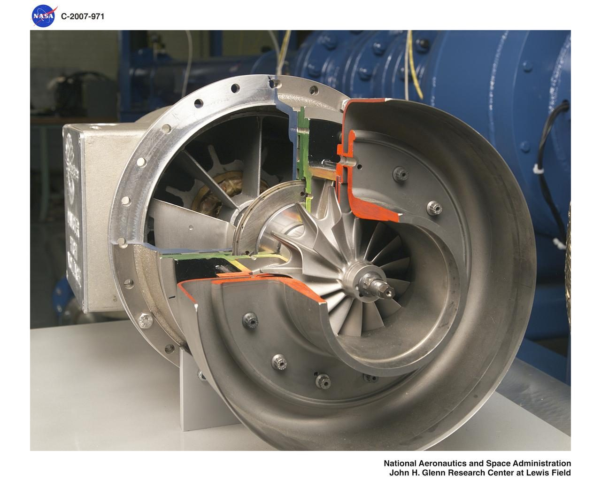
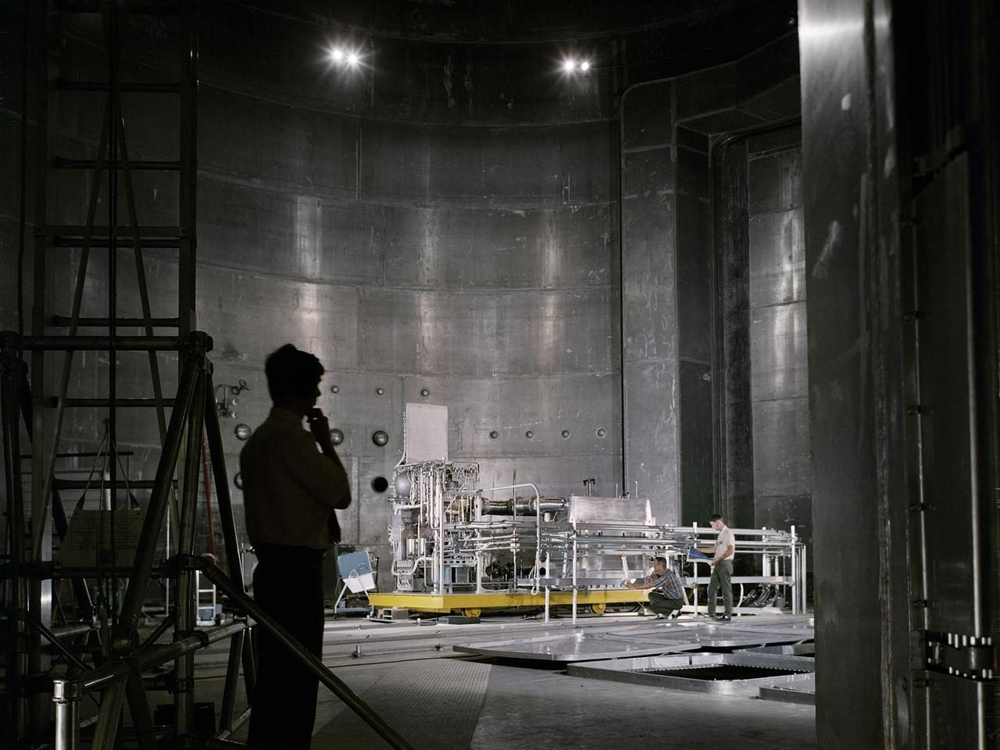
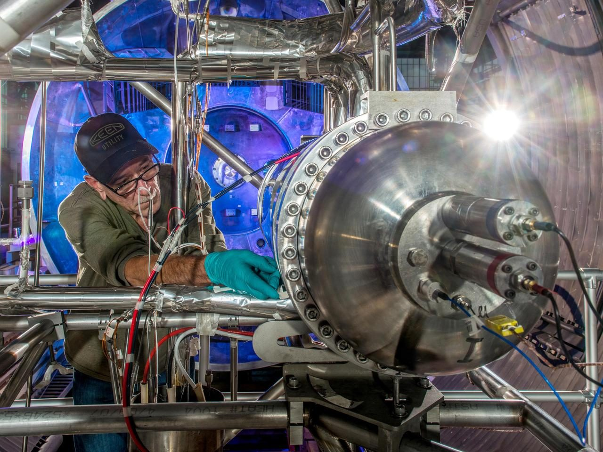
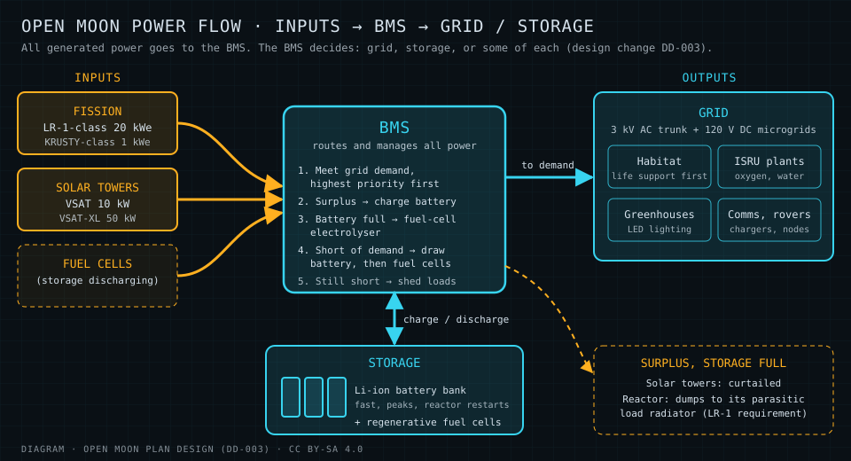

## What it is

Lunar Reactor-1 (LR-1) is NASA's planned first fission reactor on the Moon. It must deliver **at least 20 kWe**, and NASA says it [will land on the Moon in 2030](https://www.nasa.gov/lunar-surface-technology/). NASA Glenn will buy it through **SPARC** (Space Power and Reactor Capabilities), a multiple-award contract. The [draft request for proposals](https://sam.gov/opp/e11e300dbee845d195c583ff87afa81a/view) (80GRC026R0009) was posted on 30 August 2026 and amended on 16 November 2026. **No contract has been awarded.** Phase 1 is planned for [15 April 2027 to 15 October 2028](https://sam.gov/api/prod/opps/v3/opportunities/resources/files/6b927f8dc6c843749a45b2c0589bf0e7/download) and ends at a preliminary design review.

The target has moved several times:
- **40 kWe** class in the 2022 concept contracts ([NASA](https://www.nasa.gov/news-release/nasa-announces-artemis-concept-awards-for-nuclear-power-on-moon/))
- **≥100 kWe** with closed Brayton in NASA's August 2025 request ([NASA](https://www.nasa.gov/centers-and-facilities/glenn/nasa-seeks-industry-feedback-on-fission-surface-power/))
- **≥20 kWe** in the White House NSTM-3 memorandum of April 2026 ([OSTP](https://www.whitehouse.gov/wp-content/uploads/2026/04/NSTM-3-2026_04_14-corrected.pdf)) and the SPARC draft ([NASA](https://sam.gov/api/prod/opps/v3/opportunities/resources/files/6b927f8dc6c843749a45b2c0589bf0e7/download))

Its sister reactor will fly first. **Space Reactor-1 Freedom** is a 20 kWe HALEU reactor with closed Brayton conversion. It will power a spacecraft to Mars, with launch targeted for late 2028. NASA says SR-1 "will inform and enable Lunar Reactor-1" ([NASA](https://www.nasa.gov/mission/space-reactor-1-freedom/)).

## How it works

NASA's block diagram has six parts ([NASA SPARC Industry Day](https://sam.gov/api/prod/opps/v3/opportunities/resources/files/6b927f8dc6c843749a45b2c0589bf0e7/download)):

1. **Fission reactor and shield.** The reactor burns HALEU (high-assay low-enriched uranium, under 20% uranium-235). A shield protects people in a 36° cone toward the base.
2. **Heat source heat exchanger (HSHX).** Passes reactor heat into the working gas.
3. **Power conversion system (PCS), closed Brayton.** A sealed gas loop. The hot gas spins a turbine, which drives the compressor and an alternator on the same shaft.
4. **Heat rejection system (HRS).** Radiators throw the waste heat to the sky.
5. **Controller and PMAD.** Runs the reactor and steps the power up to **3 kV RMS AC** for the cable to the user.
6. **Parasitic load radiator (PLR).** Any power the user does not take is dumped here as heat. NASA's startup sequence brings the reactor to a stable state with all power going to the PLR.

NASA's 2025 reference design rated 10 kWe-class Brayton converters at **TRL 4** and Stirling at TRL 5. It found Brayton about 10% heavier but simpler on the electrical side ([INL/NASA webinar](https://inl.gov/content/uploads/2024/11/FSP-Technical-Maturation-Webinar-Final-250924-1.pdf)).

## Real hardware so far

**No LR-1 hardware exists yet**, and no design has been chosen. The photos below are real NASA tests of the technologies LR-1 will use.

<figure class="tfig"></figure>

Photo Cutaway of closed-Brayton turbomachinery from NASA Glenn's Dual Brayton Power System work (photo dated 2003). Credit: NASA Glenn. Licence: NASA media (public domain in the US). <a href="https://images.nasa.gov/details/GRC-2007-C-00971">Image source ↗</a>

<figure class="tfig"></figure>

Photo A 15–20 kW Brayton cycle space power system set up in the Space Power Facility vacuum chamber at NASA's Plum Brook Station, Ohio, 1969. It was the facility's first test. Credit: NASA Glenn. Licence: NASA media (public domain in the US). <a href="https://images.nasa.gov/details/GRC-1969-C-02599">Image source ↗</a>

<figure class="tfig"></figure>

Photo A technician works on a 10 kW Stirling power conversion unit, part of NASA's Fission Surface Power Technology Demonstration Unit, a non-nuclear system test. This is the earlier Stirling path: four such units on a 180 kW reactor would give 40 kWe. Credit: NASA Glenn. Licence: NASA media (public domain in the US). <a href="https://images.nasa.gov/details/GRC-2015-C-06315">Image source ↗</a>

## Testing

| When | Test | Status |
|---|---|---|
| 1969 | 15–20 kW Brayton space power system in the Space Power Facility vacuum chamber | Done ([NASA](https://images.nasa.gov/details/GRC-1969-C-02599)) |
| 2018 | KRUSTY: 28-hour nuclear test of a heat-pipe reactor, but with Stirling engines, not Brayton | Done ([Poston et al. 2020](https://ntrs.nasa.gov/citations/20205009351)); see the Kilopower card |
| 2027–2028 | **Engineering Test Unit (ETU).** A non-nuclear, electrically heated reactor simulator joined to flight-like subsystems, tested in thermal vacuum, including off-nominal and fault cases | Required in SPARC Phase 1 ([NASA](https://sam.gov/api/prod/opps/v3/opportunities/resources/files/6b927f8dc6c843749a45b2c0589bf0e7/download)) |
| 2027–2028 | **Radiation exposure tests** of ETU parts and other nuclear components | Required in SPARC Phase 1 ([NASA](https://sam.gov/api/prod/opps/v3/opportunities/resources/files/6b927f8dc6c843749a45b2c0589bf0e7/download)) |
| Proposals | Bidders must also plan material, component, nuclear, life, subsystem and integrated tests for the flight unit | In the draft evaluation criteria ([NASA](https://sam.gov/api/prod/opps/v3/opportunities/resources/files/6b927f8dc6c843749a45b2c0589bf0e7/download)) |
| Late 2028 | **SR-1 Freedom** flies a 20 kWe HALEU Brayton reactor in space, switched on within 48 hours of launch | Planned ([NASA](https://www.nasa.gov/mission/space-reactor-1-freedom/), [Wikipedia](https://en.wikipedia.org/wiki/Space_Reactor%E2%80%911_Freedom)) |
| 2030 | LR-1 lands; controlled startup into the PLR, then power to the user | Planned ([NASA](https://sam.gov/api/prod/opps/v3/opportunities/resources/files/6b927f8dc6c843749a45b2c0589bf0e7/download)) |

## Power output and power type

Key draft requirements ([NASA SPARC Industry Day](https://sam.gov/api/prod/opps/v3/opportunities/resources/files/6b927f8dc6c843749a45b2c0589bf0e7/download)):

| Item | Requirement |
|---|---|
| Power | **≥20 kWe** at the output, even after a single failure |
| Power type | **3 kV RMS AC**; the user supplies the long-distance cable (about 1 km) |
| Load | Accepts a user load from **0 to 100%** of rated output |
| Fuel / conversion | HALEU / closed Brayton cycle |
| Life | ≥5 years continuous at full power |
| Restart | Restarts without external power; runs automatically through gaps in communication |
| Site | 84°S–90°S, slopes up to 10°, 354 h of darkness |
| Mass / size | <15,000 kg with lander adapters; 4.57 m × 7.8 m stowed |
| Radiation | <5 rem/yr above background at 1 km in a 36° cone; <50 rem/yr outside it |

**Reasonable planning value for Open Moon:** **20 kWe**, continuously. That is NASA's guaranteed minimum after a single failure, and the figure NASA uses for both LR-1 and SR-1. It works out to **480 kWh a day** (Open Moon arithmetic). The SPARC draft does not set the AC frequency. NASA's earlier lunar grid trade study chose 3 kV AC ([Thomas et al. 2022](https://ntrs.nasa.gov/citations/20220011587)).

## How Open Moon uses it: the reactor feeds the BMS



In Open Moon every source, including the reactor, sends its power to the **BMS**. The BMS decides whether that power goes to the grid to meet demand, into storage, or some of each, and draws on storage when generation falls short ([design change DD-003](/decisions/#dd-003)).

1. **Reactor.** LR-1 runs at up to 20 kWe and sends 3 kV AC down the cable to the BMS hub.
2. **BMS.** Converts the incoming power and routes it: first to the grid for demand, then to charge the battery, then to the fuel-cell electrolyser. NASA Glenn has already built a modular, bidirectional converter between 120 V DC equipment and the 3 kV AC grid ([Thomas et al. 2023](https://ntrs.nasa.gov/citations/20230013309)).
3. **Storage.** A Li-ion bank with 160 kWh per reactor (8 hours at full output, to ride through a restart), plus regenerative fuel cells for long shadows.
4. **Outputs.** The grid: the habitat, ISRU plants and other loads.

**Why this fits LR-1.** LR-1 must accept any load from 0 to 100% and has its own parasitic load radiator ([NASA](https://sam.gov/api/prod/opps/v3/opportunities/resources/files/6b927f8dc6c843749a45b2c0589bf0e7/download)). So the BMS can take as much or as little as it needs at any moment, and when demand is met and storage is full, the reactor dumps the surplus as heat.

**Sizing (Open Moon arithmetic).** One LR-1 gives **480 kWh a day**. Generation must cover the base's *average* load plus losses; storage must cover *peaks* and the longest planned outage. A habitat drawing 20–50 kW (see C08.1) is above one LR-1's 20 kWe, so a crewed base needs more than one reactor, or solar towers feeding the same BMS.

## Limitations and open issues

- **No award, no hardware.** Only a draft RFP exists. NASA [keeps the right to make zero awards](https://newspaceeconomy.ca/2026/09/01/what-does-nasas-sparc-lunar-reactor-procurement-reveal-about-lunar-reactor-1/).
- **Moving requirements.** The target went from 40 to 100 to 20 kWe in four years (see above).
- **Tight schedule.** Phase 1 runs until October 2028 and ends at a preliminary design review, with a landing targeted for 2030. NASA has not published a flight-unit schedule or cost.
- **Heavy.** Up to 15 t, so it needs a human-class cargo lander. NASA set the mass and volume [to match such landers](https://sam.gov/api/prod/opps/v3/opportunities/resources/files/6b927f8dc6c843749a45b2c0589bf0e7/download). No lander has been named.
- **Brayton not yet run on a reactor.** The only recent nuclear test (KRUSTY, 28 hours) used Stirling engines ([Poston et al. 2020](https://ntrs.nasa.gov/citations/20205009351)). Brayton first flies on SR-1, which may slip.
- **Fuel supply.** HALEU depends on DOE building a [domestic supply chain](https://www.energy.gov/infrastructure/availability-high-assay-low-enriched-uranium-haleu).
- **Siting.** The radiation limit applies only at 1 km. Habitats need distance, berms or terrain shielding. The user also supplies the long-distance cable ([NASA](https://sam.gov/api/prod/opps/v3/opportunities/resources/files/6b927f8dc6c843749a45b2c0589bf0e7/download)).
- **Everything goes through the BMS.** Every watt passes through the BMS, so it is split into two independent halves with a cross-tie, and the battery into several strings (see C04.3).
